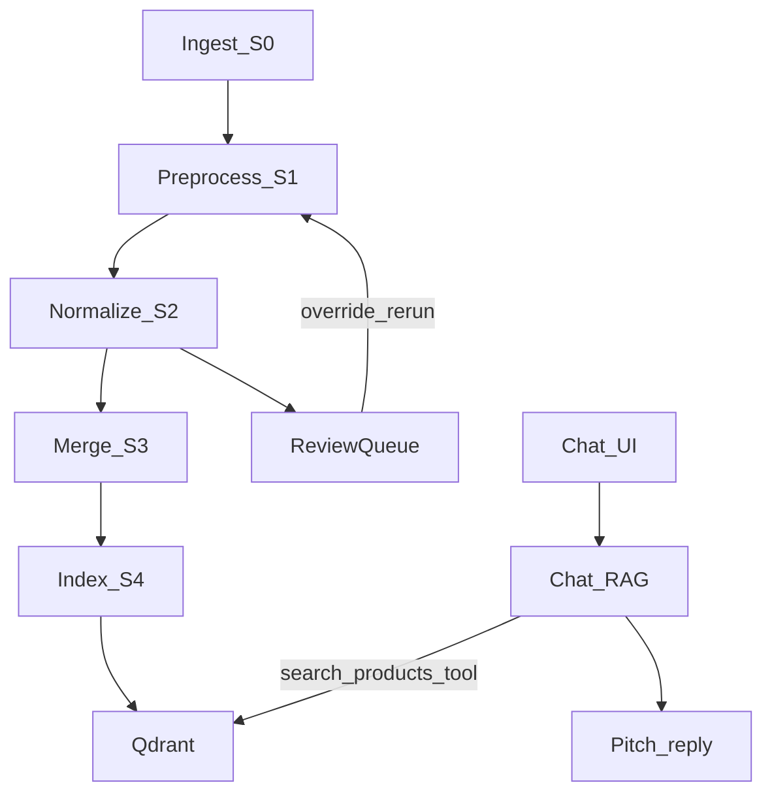
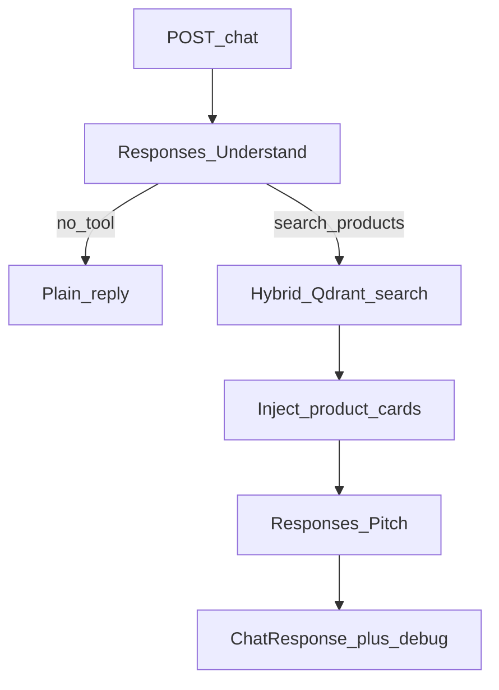

# Prism

**Talk to your HybridShelf.** Local product chatbot with a normalization pipeline, hybrid Qdrant search, and a developer debug panel.

**Stack:** React (Vite) · FastAPI · Qdrant · OpenAI `gpt-5.4-mini` (normalize / query understanding / chat) · `text-embedding-3-small` (dense) · sparse BM25-style vectors

## Architecture

```
React/Vite UI  →  FastAPI (:8009)  →  data/tenants/{id}/  +  Qdrant products_{tenant_id}
```

- **Tenancy:** `X-Tenant-Id` header (default `demo`). Each tenant has its own file tree and Qdrant collection.
- **On disk:** `raw/` → `staged/` → `normalized/` → `canonical/` (+ `overrides/`, review queue).
- **LLMs:** OpenAI only — `CHAT_MODEL` (default `gpt-5.4-mini`) and `EMBEDDING_MODEL` (`text-embedding-3-small`). Shared client in [`backend/app/openai_client.py`](backend/app/openai_client.py); optional LangSmith wrap when `LANGSMITH_API_KEY` is set.
- **Vocab:** YAML under `vocab/` constrains `category_path`, `use_case_tags`, and `target_audience` during normalize.

## Workflow

### End-to-end



### Catalog ingest and pipeline (S0–S4)

Products enter via form, paste, CSV, or file upload (or CLI synthetic + `run_pipeline`). Orchestrator: [`backend/app/pipeline/run_pipeline.py`](backend/app/pipeline/run_pipeline.py) (CLI + SSE).

| Stage | Module | LLM? | What happens |
|---|---|---|---|
| **S0 Ingest** | [`s0_ingest.py`](backend/app/pipeline/s0_ingest.py), [`file_etl/`](backend/app/pipeline/file_etl/), [`catalog_service.py`](backend/app/catalog_service.py) | Sometimes | Valid JSON/CSV with clear columns: parse only. Messy text or unmapped CSV: `chat.completions` JSON extract. PDF/DOCX/PPTX/images: extract text/tables; vision describes images, then extract → append `raw/catalog.jsonl` |
| **S1 Preprocess** | [`s1_preprocess.py`](backend/app/pipeline/s1_preprocess.py) | No | Strip HTML, canonicalize country/currency/billing, compute `price_min`/`price_max` and `content_hash`. Bad prices → `dead_letter.jsonl`. Changed hash → `needs_normalization` → `staged/` |
| **S2 Normalize** | [`s2_normalize.py`](backend/app/pipeline/s2_normalize.py) | Yes (or heuristic) | Batches of 5: structured normalize (description, pitch, category, tags, audience, aliases, plan features, confidence, flags) → `normalized/`. Flags feed the review queue unless overridden |
| **S3 Merge** | [`s3_merge.py`](backend/app/pipeline/s3_merge.py) | No | Join staged prices/plans with normalized semantics + overrides → `canonical/` with `embedding_text` and currency `display_card`. Low confidence / open flags → `review_pending` |
| **S4 Index** | [`s4_index.py`](backend/app/pipeline/s4_index.py) | Embeddings | Dense vectors + sparse BM25 → upsert into `products_{tenant}`. Skip unchanged `content_hash` unless force re-embed |

**Review loop:** Resolve flags in the UI (override) → re-run pipeline → overrides applied on normalize/merge so the same flag is not re-asked.

### Chat / RAG



1. `POST /chat` with `session_id`, `country`, messages, optional catalog title ([`backend/app/rag/chat.py`](backend/app/rag/chat.py)).
2. **Understand** — OpenAI `/v1/responses` with the `search_products` tool (`tool_choice=auto`). Small talk with no product intent can reply without searching.
3. On tool call — parse args into a `SearchRequest`, then hybrid search ([`backend/app/rag/search.py`](backend/app/rag/search.py)): embed `semantic_query` + BM25 sparse, RRF fusion, payload filters. Fallback ladder: full filters → relax price ±20% → drop tags → drop category → semantic only. Currency is bound from session country (`IN→INR`, `US→USD`, `GB→GBP`).
4. Inject up to a shortlist of product cards into the tool result (prices from `display_card` for that country).
5. **Pitch** — second `responses.create` with `previous_response_id` + tool output; model pitches ≤3 products with `[ID]` refs.
6. Response includes `reply`, `product_cards[:3]`, and a debug trace (turn flow, filters, Qdrant query, hits, injected prompt, reasoning summaries, latency/tokens).

See [Demo script](#demo-script) for a multi-turn walkthrough.

## Where LLMs are used

| # | When | How | API / model | Fallback if no key |
|---|---|---|---|---|
| 1 | Messy text / file ingest extract | `EXTRACT_SYSTEM` + truncated content → JSON `products[]` | `chat.completions` + `json_object`, `CHAT_MODEL` | Heuristic single-product parse |
| 2 | Image/PDF/DOCX ETL (≤8 images/file) | Vision message → factual description text | `chat.completions` (vision), `CHAT_MODEL` | Needs a real key (no vision fallback) |
| 3 | Pipeline normalize (changed products) | Vocab + staged payload → `NormalizationBatchResponse` (batch of 5) | `chat.completions.parse`, `CHAT_MODEL` | [`heuristic_normalize.py`](backend/app/pipeline/heuristic_normalize.py) |
| 4 | Index upsert | Embed `embedding_text` (batches of 16) | `embeddings.create`, `EMBEDDING_MODEL` | MD5 hash embedding |
| 5 | Each hybrid search | Embed `semantic_query` | `embeddings.create`, `EMBEDDING_MODEL` | Hash embedding |
| 6a | Every chat turn (understand) | System + catalog context + history; may call `search_products` | `/v1/responses`, `CHAT_MODEL` | Keyword filters + always search |
| 6b | After search (pitch) | Tool output with cards → sales reply | `/v1/responses` + `previous_response_id` | Template list of cards |

**Not LLM:** S1 preprocess, S3 merge, sparse BM25 vectors, Qdrant RRF, review store, hash ledger, CSV/JSON parsers, search fallback ladder.

**API split:** Chat uses `/v1/responses` (tools + `CHAT_REASONING_EFFORT`). Pipeline ingest/normalize use `/v1/chat/completions`. Reasoning summaries (when effort ≠ `none`) appear in the debug panel for Understand / Reply.

## Setup

```bash
# 1. Qdrant
docker compose up -d

# 2. Env
cp .env.example .env
# set OPENAI_API_KEY in .env
# optional: set LANGSMITH_API_KEY for AI trace logging (project: prism)

# 3. Backend
cd backend
uv sync
uv run python -m app.pipeline.generate_synthetic
uv run python -m app.pipeline.run_pipeline
uv run uvicorn app.main:app --reload --host 127.0.0.1 --port 8009

# 4. Frontend (new terminal)
cd frontend
npm install
npm run dev
```

Open http://localhost:5173

Health check: http://localhost:8009/health

## Demo script

1. Open **Review Queue**, resolve 1–2 flags (tap recommended or enter free text), click **Re-run pipeline**.
2. Switch to **Chat**, country **IN**.
3. Message: `i am looking for a commercial place near vaishnodevi`
4. Watch the debug panel: filters extracted (`Commercial/Offices` or `Commercial/Retail`), hybrid hits, injected prompt.
5. Follow up: `keep it under 20000000`
6. Watch filters accumulate + INR price bind; bot pitches 2–3 cards.
7. Ask: `what's the size and parking like?` — answered from injected `plan_features`.
8. Try residential: `show me 2 bhk near gift city` — should return apartments, not offices.
9. Try food service: `looking for a cafe with outdoor seating for brunch` — expect `FoodService/Cafes` plus tags like `brunch` / `outdoor_seating`.

## Verify gates (quick)

| Phase | Check |
|---|---|
| 1 | `curl localhost:6333/collections`, `curl localhost:8009/health`, UI two panes |
| 2 | Synthetic JSONL validates; `defect_manifest.json` counts match |
| 3 | Pipeline summary prints `flag_metrics`; Qdrant point count ≈ canonical |
| 4–6 | 3-turn salon conversation; debug tabs populated |
| 7 | Override → rerun → flag not re-asked |

## Notes

- Set a real `OPENAI_API_KEY` in `.env` to use `gpt-5.4-mini` for normalize / chat. If the key is missing or still the placeholder, the app falls back to a heuristic normalizer + hash embeddings so the demo still runs locally.
- Chat (query understanding + pitch) uses OpenAI `/v1/responses` so function tools and `CHAT_REASONING_EFFORT` (default `medium`) work together. Pipeline normalize/ingest remain on `/v1/chat/completions`.
- With reasoning enabled, chat requests an auto reasoning **summary** and shows it in the debug panel (Understand / Reply phases). Summaries are approximate; the full private chain-of-thought is not exposed.
- **LangSmith:** set `LANGSMITH_API_KEY` (and optionally `LANGSMITH_PROJECT`, default `prism`). When present, OpenAI chat/embedding calls are wrapped and sent to LangSmith. Without the key, the app runs normally with tracing off. Check `/health` → `langsmith_key_present`.
- Backend defaults to port **8009** (see `vite.config.ts` proxy). Port 8000 is often blocked on Windows.
- Qdrant: `docker compose up -d` or any local Qdrant on `QDRANT_URL` (default `http://localhost:6333`).
- First UI visit runs a guided onboarding (setup checklist → how to use). Replay via **Replay tour** in the top bar.
- **Vocab coverage:** besides real estate, travel, food service, electronics, and other existing domains, `vocab/` also covers Healthcare, Hygiene, Finance, Clothing, Hardware, Trading, NGO, Education, Photography, SolarPanels, SolarManufacture, and Paint.
